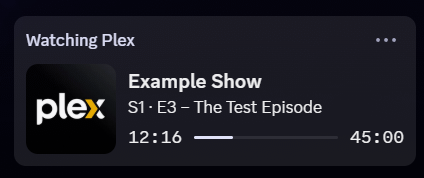

# Plex Discord Presence

Show what you are watching on Plex as Discord Rich Presence.



*Your Discord profile while an episode plays (sample data from `node presence.js test`).*

- **Zero dependencies.** One file, Node.js built-ins only. No `npm install`.
- **LAN-only.** While running it only talks to your Plex server on your network
  and to the Discord desktop app on your computer. No tracking, no image hosts.
- **"Watching" activity type**, so your member list status reads
  "Watching <show>" instead of "Playing Plex".
- **Browser sign-in.** No hunting for your Plex token.
- **Autostart** on Windows, macOS and Linux with one command.

## Requirements

- [Node.js](https://nodejs.org) 18 or newer
- The Discord **desktop** app running on the same computer (the browser version
  has no Rich Presence)
- A Plex Media Server you can reach on your network
- In Discord: *Settings → Activity Privacy → Share your detected activities*
  must be on

## Quick start

Download or clone this folder, then start the file for your system:

| System | Install | Uninstall |
| --- | --- | --- |
| Windows | double-click `install-windows.bat` | `uninstall-windows.bat` |
| macOS | double-click `install-mac.command` (first time: right-click → Open) | `uninstall-mac.command` |
| Linux | run `./install-linux.sh` in a terminal | `./uninstall-linux.sh` |

A browser window opens for the Plex sign-in; allow access there and you are done.
The helper scripts live in `scripts/` and are started by the files above.

The installer runs three steps you can also run yourself:

```sh
node presence.js setup     # sign in to Plex in your browser, pick your server
node presence.js install   # start automatically at login
node presence.js status    # check that everything works
```

## Commands

| Command | What it does |
| --- | --- |
| `setup` | Opens the Plex sign-in page in your browser. After you allow access, it finds your servers, picks the best local connection and saves the config. Options: `--relogin`, `--server <name>`, `--user <name or "all">`, `--no-browser` (prints the link instead). |
| `run` | Runs in the foreground (default command). Stop with Ctrl+C; the activity is cleared on exit. |
| `install` | Copies the script to `~/.plex-discord-presence/app/` and starts it at login: a hidden Scheduled Task on Windows (restarts on failure), a LaunchAgent on macOS, a systemd user service on Linux. Run it again after updating to restart with the new version. |
| `uninstall` | Removes the autostart. `--purge` also deletes config, sign-in token and logs. |
| `status` | Shows config, sign-in state, autostart state and whether Plex and Discord are reachable. Never prints the token. |
| `test` | Shows a test activity on Discord for 20 seconds. |

## Configuration

Everything lives in `~/.plex-discord-presence/`
(`%USERPROFILE%\.plex-discord-presence\` on Windows):

- `config.json` – settings (see below)
- `token.json` – your Plex sign-in token, readable only by your user account
- `presence.log` – log file (rotated at 1 MB)

`config.json` (see `config.example.json`):

| Key | Default | Meaning |
| --- | --- | --- |
| `discordClientId` | `1566630137603162182` | Discord application to show the activity as. See below. |
| `largeImageKey` | `logo` | Art asset key of the Discord application. |
| `largeImageText` | `Plex` | Tooltip of the large image. |
| `smallImagePlayingKey` / `smallImagePausedKey` | empty | Optional small corner icon while playing/paused. Only works if your Discord app has assets with these keys. |
| `pollIntervalSeconds` | `5` | How often Plex is asked what is playing. |
| `plexServerUrl` | set by `setup` | Your server, usually `https://<ip-with-dashes>.<id>.plex.direct:32400`. For `plex.direct` addresses the IP is taken from the name, so no DNS lookup is needed (works behind routers with DNS rebinding protection). |
| `plexConnectAddress` | empty | Optional IP to connect to instead of the URL's host. |
| `plexTlsServername` | empty | Optional certificate name to check (if you use an IP in `plexServerUrl`). |
| `plexUser` | your account | Whose playback to show: `"all"`, a user ID, a username, or a list. On your own server, the owner is user ID `1`. |
| `hideWhenPaused` | `false` | Clear the activity while paused instead of showing "Paused – …". |
| `showPausedState` | `true` | Prefix the second line with "Paused – " while paused. |
| `mediaTypes` | episode, movie, clip, video | Which Plex item types to show. |

Restart after changing the config (`node presence.js install` again, or
stop and start `run`).

## The Discord application ID

Discord shows a Rich Presence under the name and art of a *Discord
application*. By default this project uses a shared application called
**Plex** with a Plex logo. Application IDs are public, not secrets, and using
the default shows nothing about the person who created it – only the name
"Plex" and the logo.

You can use your own application instead, for example to change the name or
add icons:

1. Go to <https://discord.com/developers/applications> and create a new
   application. Its name is shown next to the activity, so "Plex" is a
   good choice.
2. Under *Rich Presence → Art Assets*, upload an image with the key `logo`
   (optionally also icons for `smallImagePlayingKey` / `smallImagePausedKey`).
3. Copy the *Application ID* into `discordClientId` in `config.json`.

## Privacy

- `setup` contacts `plex.tv` to sign you in and to list your servers. That is
  the only time anything outside your network is contacted.
- At runtime the script calls `GET /status/sessions` on your Plex server and
  sends the activity to Discord over the local IPC socket/pipe.
- The token is stored in `token.json` with permissions for your user only
  (`chmod 600`, or an ACL for your account on Windows). It is never printed or
  written to the log. Revoke it any time at
  <https://app.plex.tv/desktop/#!/settings/devices/all> ("Plex Discord Presence").
- Posters are not shown: Discord can only display images from public URLs,
  which would mean uploading what you watch to a third-party image host.

## Uninstall

```sh
node presence.js uninstall           # remove autostart, keep config
node presence.js uninstall --purge   # also delete config, token and logs
```

Then delete this folder. Optionally revoke the device in your Plex account
settings.

## Troubleshooting

- **Nothing shows up:** run `node presence.js status` and `node presence.js test`.
  Check that Discord's activity sharing is on and that you are not using the
  browser version of Discord.
- **"Plex HTTP 401":** your token was revoked; run `node presence.js setup --relogin`.
- **Plex not reachable:** make sure this computer is on the same network as the
  server, or set `plexServerUrl` manually.
- **Logs:** `~/.plex-discord-presence/presence.log`.

## Development

```sh
npm test    # unit tests + an end-to-end test with mock Plex/Discord (no network)
```

## License

MIT – see [LICENSE](LICENSE). Not affiliated with Plex Inc. or Discord Inc.
